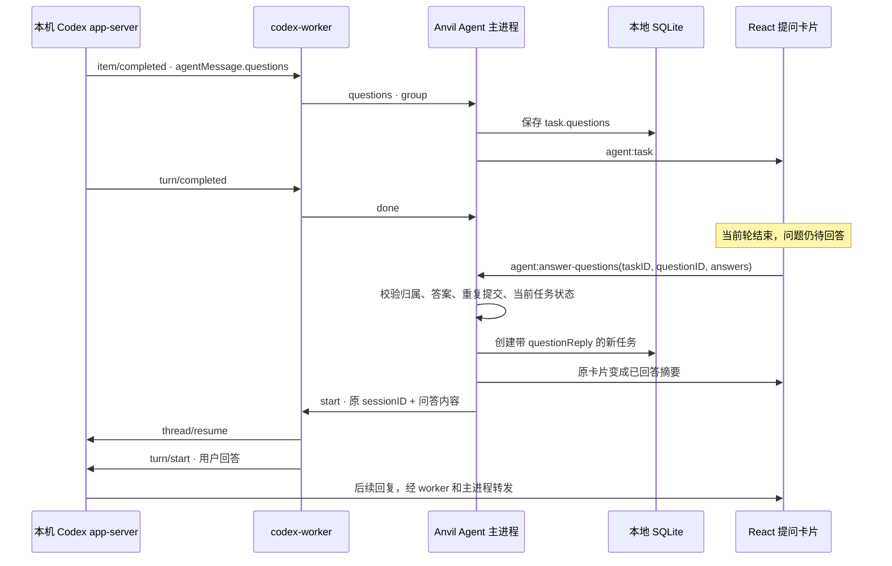

# Managed Agent 交互式提问

## 问题

Codex 已返回交互式问题，但 Anvil 首版只消费文本增量。实际消息中的 `agentMessage.questions` 被忽略，用户只能看到“已发出提问”，没有可回答的界面。

## 本次范围与设计

接通本机 Codex 的异步问题：聊天内嵌卡片、单选或自定义文字、显式提交、已回答摘要、本地持久化，以及原线程续聊。任务完成和问题待回答是两个不同状态。首版允许在模型运行时填写，等当前任务结束后提交；不自动提交预选项。阻塞式 `item/tool/requestUserInput` 和 MCP 表单本次不包含，继续明确报错。

前端不从“请回答”等自然语言猜测问题，只渲染经过校验的结构化数据。每组问题以 Codex 消息 ID 去重；问题及对应的回答记录进入现有 SQLite task record，重启可恢复。提交采用源任务和问题 ID 绑定，拒绝重复、空白、超长和跨会话回答。回答作为新任务沿用原线程及当前文件夹授权，保留在聊天历史。

本次截图中的历史 demo 已丢失结构化字段，需要从 Codex `thread/read` 读取原消息并定向补回；新消息在接收时保存，无需从本机日志猜测或解析。

## 验证标准

- 单选、自定义输入、多题、没有选项时均可提交；不能空提交或重复提交。
- `item/started` / `item/completed` 重复事件只产生一组卡片，turn 完成不会清除问题。
- 回答恢复同一个 Codex 线程；重启后仍显示已回答；执行中/归档/已删除会话拒绝提交。
- 协议和任务状态测试、前端交互验证、真实 Codex 提问和续答、打包启动验证。

## 原理与接口

### 一、Codex 消息和 Anvil 消息

Codex app-server 用逐行 JSON-RPC 与适配进程通信。本次真实消息的核心结构如下（省略时间和线程字段）：

```json
{
  "method": "item/completed",
  "params": {
    "item": {
      "type": "agentMessage",
      "id": "call_example",
      "delivery": "async",
      "text": "你希望我接下来演示哪种能力？…",
      "questions": [{
        "title": "你希望我接下来演示哪种能力？",
        "options": ["分析代码", "修复 Bug", "编写测试"]
      }]
    }
  }
}
```

问题是消息的结构化字段，不是 Markdown，也不是从 `item/agentMessage/delta` 的文字中提取出来的。实际工具 `request_user_input_async` 的调用立即得到 accepted，模型随后可以继续输出并结束当前 turn。不能因此认为问题已回答，也不能在 turn/completed 时删除卡片。

适配层监听 `item/started` 和 `item/completed` 的 agentMessage，提取 questions 并发送内部消息：

```json
{
  "type": "questions",
  "group": {
    "id": "call_example",
    "questions": [{"title": "选择任务", "options": ["分析", "测试"]}]
  }
}
```

两个事件可能包含同一个问题组，因此主进程以 group.id 做 upsert。相同数据重复到达不重复渲染。每组最多 10 题，每题最多 20 个选项；题目和选项经过类型、长度校验，前端作为普通文本渲染。

### 二、数据流与职责



- **Codex**：负责问题生成、模型上下文、工具循环和原生会话存储。
- **worker**：把 Codex 协议转换成 Anvil 内部事件，不负责 React、SQLite 或问题的最终状态。
- **Agent 主进程**：验证数据、持久化、去重、执行任务和绑定回答。渲染进程不能指定任意 Codex session ID。
- **preload / IPC**：提供 `answerQuestions(taskID, questionID, answers)`，沿用已登录账号和受信窗口检查。
- **React**：选择项、自定义输入、提交中、错误重试及已回答摘要。

### 三、持久化和防重

现有 `tasks.record` JSON 增加两个字段，不新建独立数据库表：

```ts
// 原提问任务
questions?: { id: string; questions: { title: string; options?: string[] }[] }[];
// 用户回答产生的新任务；仅在主进程存储
questionReply?: { taskID: string; questionID: string; answers: string[] };
```

展示源问题时，主进程查找同会话内指向它的 questionReply，返回派生的 `answer: { values, taskID }`。这样回答任务本身就是持久化凭据：即使保存新任务后、通知前端前应用退出，重启也能恢复已回答状态，不能再次发送同一组答案。

“已回答”表示 Anvil 已接收回答并创建后续任务，不代表后续推理或代码验收成功；后续任务的失败/取消仍单独展示。模型调用失败后，用户可以在普通输入框继续对话。

卡片初始不选中任何选项。选择只改变本地表单，点击提交才发送；多题要求全部填写，每题允许 1–4000 字符。发送失败保留输入并显示错误。模型仍运行时可填写，但不能提交。fork 中复制的问题作为只读历史展示，不会向原线程发送答案。

### 四、异步与阻塞式提问的区别

| 类型 | 返回形式 | 当前轮是否必须等待 | 本次处理 |
| --- | --- | --- | --- |
| `request_user_input_async` | agentMessage.questions | 否，可以先完成 | 保存卡片，用户答复启动同线程下一轮 |
| `item/tool/requestUserInput` | 带 request ID 的服务端请求 | 由 isBlocking 指示 | 暂未接入，明确报错 |
| MCP elicitation | 服务端请求及表单 schema | 取决于协议和请求 | 暂未接入，明确报错 |

这里不能把所有交互都当成一次 permission approval，也不能把已经结束的异步问题作为仍在等待的 JSON-RPC 请求去答复。当前实现把问答作为正常用户输入续接，并不依赖桌面客户端专用的消息标签。

## 代码入口

- [Codex worker](../desktop/main/codex-worker.ts)：提取原生问题事件。
- [问题校验](../desktop/main/agent-questions.ts)：校验问题和答案。
- [Agent](../desktop/main/agent.ts)：去重、派生已回答状态、answerQuestions 和续聊。
- [共享类型](../desktop/shared/api.ts)、[IPC 注册](../desktop/main/index.ts)、[preload](../desktop/preload/index.ts)：进程之间的契约。
- [卡片组件](../desktop/renderer/agent-questions.tsx)、[聊天页面](../desktop/renderer/conversation.tsx)：渲染和交互。
- [任务存储](../desktop/main/conversations.ts)：SQLite task record。
- [状态测试](../test/desktop/agent-questions.test.ts)、[Codex 协议测试](../test/desktop/codex.test.ts)。

## 验证记录

2026-11-11，本机 Codex 的真实测试成功生成结构化问题；选择 `COBALT-7319` 后，Anvil 恢复原线程，Codex 正确回复该标记，回答关联保存成功。自动化测试覆盖结构校验、重复事件、完成后保留、重启、重复回答、错误 ID、归档/删除/执行中拦截和 fork 只读。

协议以本机 `codex-cli 0.167.0-alpha.3.2` 生成的 schema 和真实 `thread/read` 返回为依据。此版本的 questions 字段需要在升级 CLI 后继续做兼容测试。生命周期参考 [OpenAI app-server 文档](https://learn.chatgpt.com/docs/app-server#lifecycle-overview)，整体接入见 [Managed Agent 设计](managed-agents.md)。
