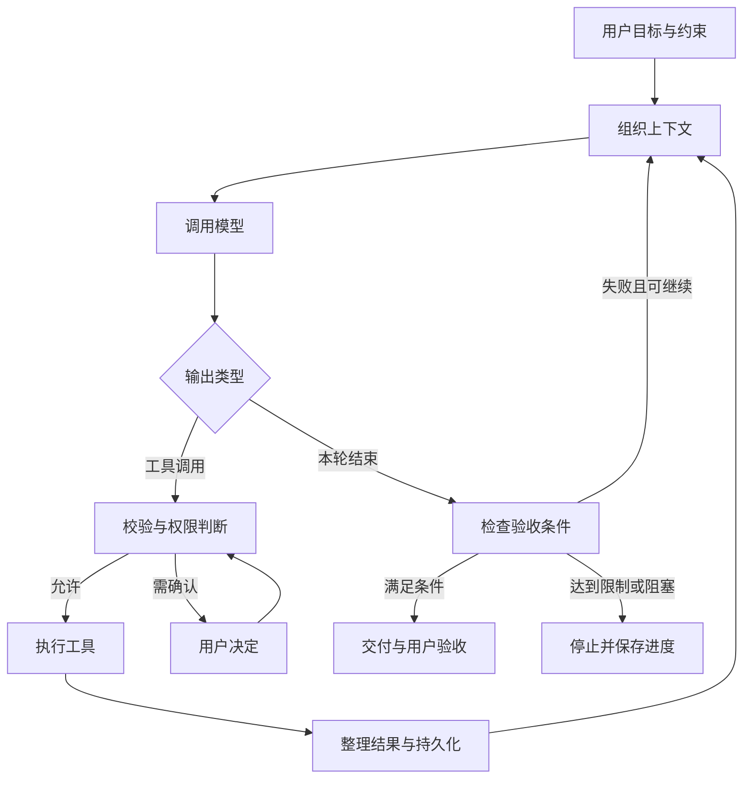

# Harness 架构分析与 Anvil 的边界

日期：2026-11-01。

本文件记录当前讨论和代码核查结果，不是已完成能力清单或性能排行榜。OpenCode 实现依据仓库实际安装的 `@opencode/sdk` / `@opencode/core` 2.0.0；其他产品依据官方公开资料。未公开的内部实现不作推断。后续版本可能改变这些行为。

## 概念与整体结构

模型根据输入产生文字或工具调用；agent loop 反复调用模型、执行工具并返回结果；harness 管理这个循环，以及上下文、权限、状态、恢复、预算和验证。产品再将这些能力组织成具体工作流程。

模型决定下一步行动，程序执行授权、资源限制和状态转换。可靠性来自这些机制与模型的配合，不能单凭循环次数或子 agent 数量判断。

| 模块 | 关键问题 |
| --- | --- |
| 目标与任务状态 | 保留哪些需求、约束和完成条件？ |
| 上下文组织 | 每轮选择哪些指令、历史、代码和外部资料？ |
| 模型适配 | 如何处理供应商协议、工具格式、推理和流式输出差异？ |
| 执行循环 | 什么时候继续、暂停、重试、结束？ |
| 工具系统 | 如何搜索、编辑、运行命令，并返回足够清楚的反馈？ |
| 权限与隔离 | 哪些操作允许执行，执行后能访问哪些资源？ |
| 压缩与记忆 | 如何保留重要信息，检索历史并处理过时结论？ |
| 持久化与恢复 | 中断前哪些动作已经发生，如何避免重复副作用？ |
| 验证与交付 | 什么证据足以支持完成声明？ |
| 观测与评测 | 失败在哪里，改动是否真的改善成功率和成本？ |

需要区分三种循环：

- 工具循环：搜索、读取、编辑、执行命令，支持模型连续行动。
- 验收循环：检查失败后，将证据交回模型修复，再次检查。
- 长期任务循环：完成阶段目标、保存可接手的进度，跨会话继续工作。

模型结束一轮、验收命令通过和用户目标完成是不同事件。测试只能证明其覆盖的条件，不能替代完整需求验收。

## OpenCode 2.0 的执行机制

Anvil 在 [worker.mjs](../runtime/opencode/worker.mjs) 中创建 OpenCode host，创建或恢复 session，调用 `sessions.prompt`，并消费事件。

从安装包中对应 `src/session/runner/llm.ts`、`step.ts`、`retry.ts`、`compaction.ts` 和 `run-coordinator.ts` 的实现可确认：

1. 会话协调器管理运行中的执行、待处理唤醒和中断。
2. 每步加载会话、agent、模型、工具和消息，生成模型请求。
3. 检查上下文容量，必要时压缩；对供应商报告的上下文溢出提供恢复分支。
4. 消费文字、工具调用、结束状态、错误和用量等流式事件。
5. 工具调用可启动独立执行任务，在该步结束前收集结果；输出经过截断处理。该能力不表示任意修改操作都适合并发。
6. 区分限流、传输故障、不完整输出、认证失败等错误，分别决定重试、恢复或失败。
7. 根据工具续执行需求和执行结果决定是否继续。配置了 agent 步数上限时，达到上限会禁用工具并要求总结。工具拒绝和用户中断也影响退出流程。

SDK 是嵌入入口，Core 承担主要执行机制。Bun 在当前 Anvil 中负责运行和编译打包，不负责规划策略或模型推理。

公开配置说明：[agents](https://dev.opencode.ai/v2/docs/agents/)、[compaction](https://dev.opencode.ai/v2/docs/compaction/)、[permissions](https://dev.opencode.ai/v2/docs/permissions/)。本文没有把旧 V1 的实现细节直接套用到 V2。

## 几个重要边界

| 概念 | 区别 |
| --- | --- |
| 历史与上下文 | 数据库可以保存全部记录，单次模型请求只携带组织后的部分内容 |
| 压缩与长期记忆 | 压缩为有限上下文腾出空间；长期记忆还要处理选择、检索和失效 |
| 确认与沙箱 | 确认决定能否执行；沙箱限制执行时实际可访问的资源 |
| 工具与 MCP | 工具是行动能力，MCP 是连接工具和资源的一种协议 |
| Skill 与 agent | Skill 提供流程和知识；agent 还具有模型、执行状态和循环 |
| 多工具与多 agent | 工具并发不同于拥有独立上下文和任务状态的多个 agent |

目录提示词不是 OS 访问控制。截断或总结工具输出也可能遗漏关键信息。恢复会话不代表恢复了之前终端进程中的全部状态。

## 产品机制比较

以下是设计取向归纳，不代表质量排名，也不把公开文档未提及的能力视为不存在。

| 产品 | 公开机制与可借鉴之处 |
| --- | --- |
| OpenCode | 可检查的内核、多供应商接入、工具与权限机制；适合作为模型可替换产品的执行基础 |
| Claude Code / Agent SDK | 上下文获取、行动、验证的持续循环，以及可复用的 agent SDK；值得研究工具和上下文如何配合 |
| Codex | 开源 harness 与 App Server 协议；会话、事件、审批和产品界面之间有明确接口 |
| Cursor | 指令、工具、模型共同构成 agent，并针对支持的模型调整；多模型支持需要实际适配 |
| Aider | repository map 与修改后的 lint/test 反馈；较聚焦的上下文和验证策略同样值得借鉴 |

参考：

- [Claude Code 如何运行](https://code.claude.com/docs/en/how-claude-code-works)
- [Claude Agent SDK](https://code.claude.com/docs/en/agent-sdk/overview)
- [长期运行 harness](https://www.anthropic.com/research/effective-harnesses-for-long-running-agents)：跨窗口执行还需要进度记录与明确的阶段成果。
- [Codex harness 平台说明](https://developers.openai.com/blog/codex-as-a-platform)
- [Codex App Server](https://learn.chatgpt.com/docs/app-server)
- [Codex 沙箱](https://learn.chatgpt.com/docs/sandboxing)
- [Cursor Agent](https://cursor.com/docs/agent/overview)
- [Aider repository map](https://aider.chat/docs/repomap.html)
- [Aider 测试反馈](https://aider.chat/docs/usage/lint-test.html)

## Anvil 当前承担的职责

| 能力 | 当前归属与限制 |
| --- | --- |
| 模型与工具循环 | 复用 OpenCode；当前固定 BytePlus / DeepSeek 接入 |
| SDK 会话与上下文 | 复用 OpenCode，恢复原 SDK session |
| 产品历史与任务状态 | Anvil 管理 SQLite、对话关系和公开任务状态 |
| 权限交互 | Anvil 展示请求并转交用户决定 |
| 执行隔离 | 独立进程和环境变量控制，尚非完整 OS 沙箱 |
| 验收修复 | Anvil 固定命令与目录，默认最多两次修复、单次检查 120 秒、总任务 15 分钟 |
| 执行观测 | 主要接入文字、权限和终态，尚未完整记录和展示工具链、用量与压缩事件 |
| 长期任务与评测 | 尚未形成完整机制 |

验收修复次数不等于工具调用次数。没有验收命令时，模型正常结束记录为 unverified；命令通过才记录为 completed。测试文件仍可能被获准的工具修改，因此当前不是独立、不可被干预的验收体系。实现见 [agent.ts](../desktop/main/agent.ts) 和 [acceptance.ts](../desktop/main/acceptance.ts)。

## 建议的后续研究，不代表已批准实施

1. 建立完整执行观测：模型轮次、工具请求与结果、耗时、用量、压缩、重试、停止原因。记录需要脱敏并限制输出体积。
2. 建立一小组固定任务：定位问题、跨文件修改、测试修复、多目录任务、中断恢复。
3. 分开比较变量：固定模型和预算比较 harness，固定 harness 比较模型；记录成功率、成本、耗时和人工介入次数。
4. 根据失败类型优化：缺上下文改善检索，反复改错改善工具反馈，忘记约束改善任务状态，过早结束改善验收。

当前判断是先复用执行内核，同时掌握任务定义、上下文策略、授权边界和验证标准。是否替换 OpenCode，应由可复现的能力限制与评测结果决定，不因产品需要独立界面而重写整个内核。
